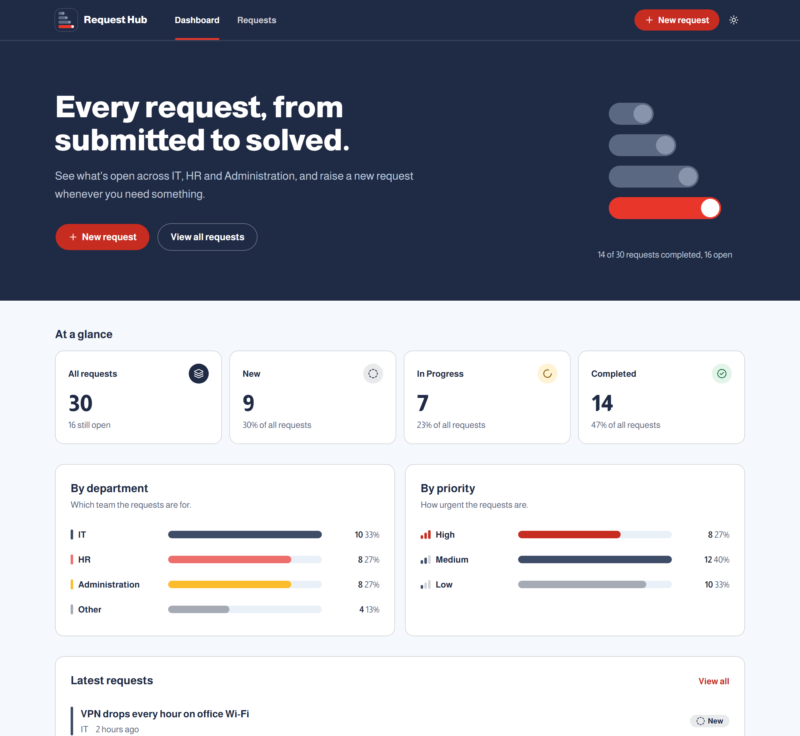
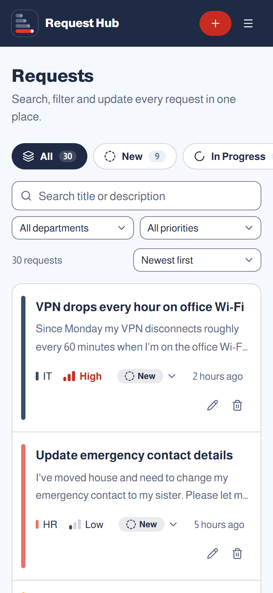
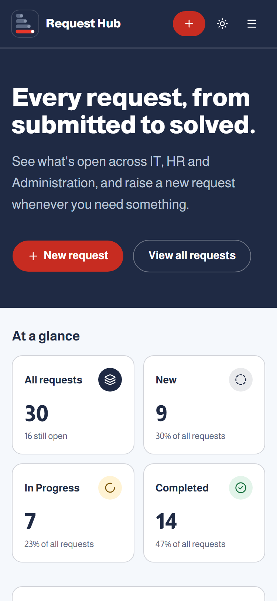
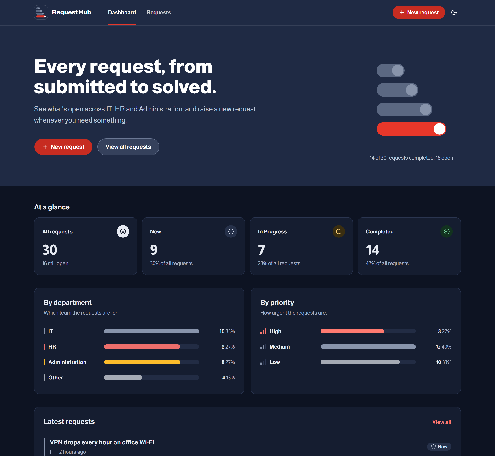
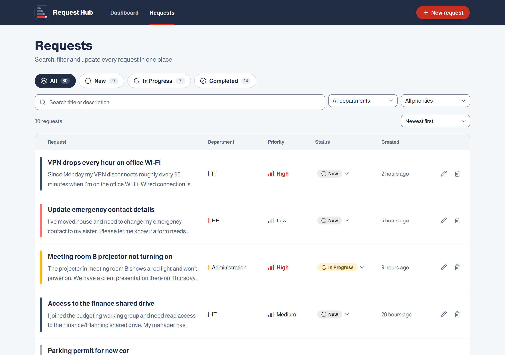
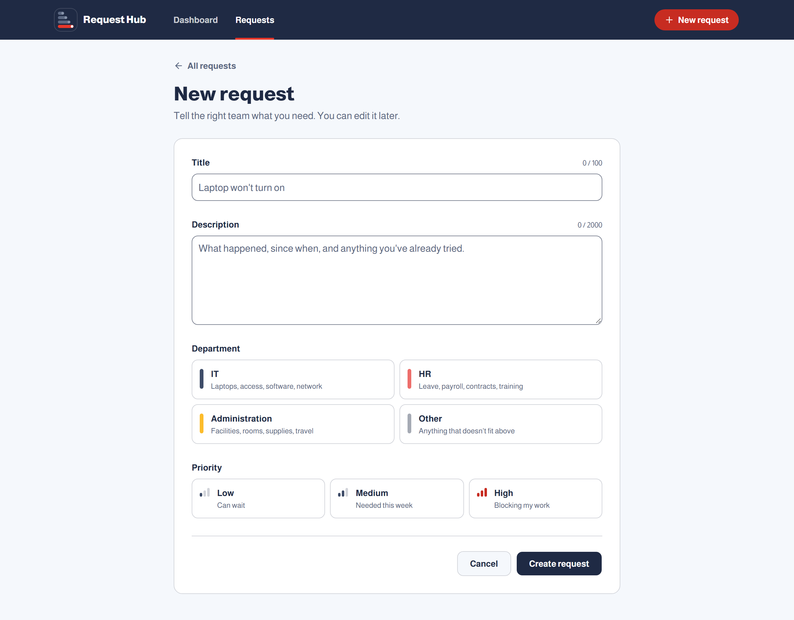
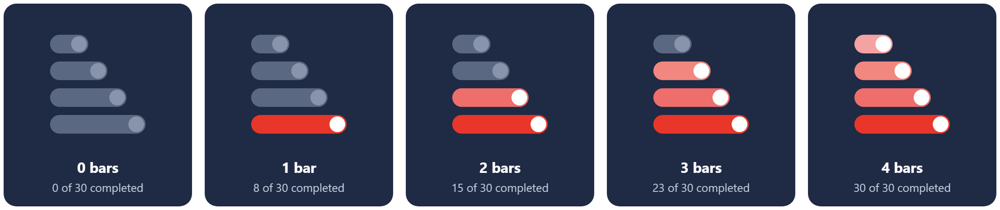

# Request Hub

An internal service desk where employees submit, track and update requests to
IT, HR and Administration.

**Live:** https://request-hub-ten.vercel.app · **Health:** [`/api/health`](https://request-hub-ten.vercel.app/api/health)



<p align="center">
  
  &nbsp;
  
</p>

<details>
<summary>More screenshots: dark mode, requests list and new-request form (desktop)</summary>





Screenshots are taken from the live site by `node scripts/capture-screenshots.mjs`.
</details>

---

## Contents
1. [Project overview](#1-project-overview)
2. [Run it locally](#2-run-it-locally)
3. [Technologies](#3-technologies)
4. [AI tools and how they were used](#4-ai-tools-and-how-they-were-used)
5. [Development approach](#5-development-approach)
6. [Challenges and how they were resolved](#6-challenges-and-how-they-were-resolved)
7. [Known limitations and future improvements](#7-known-limitations-and-future-improvements)
8. [Further documentation](#8-further-documentation)

---

## 1. Project overview

| Requirement | How it works |
|---|---|
| **Create** a request | Form with title, description, department (IT, HR, Administration, Other) and priority (Low, Medium, High). Errors appear under each field. The server re-validates with the same rules, so bad input is rejected even if the browser is bypassed. |
| **View** all requests | One responsive list, newest first: a coloured department tab, title and description preview, priority bars, status, and a relative time ("3 hours ago", exact date on hover). Each title opens a read-only detail page with the full description, both timestamps and the status control. |
| **Edit and delete** | The same form, pre-filled, from the pencil icon or the detail page. Delete asks for confirmation and names the request. A missing request shows a not-found page. |
| **Update status** | New / In Progress / Completed, changed straight from the list or the detail page. The change shows at once, rolls back with an explanation if saving fails, and persists after a reload. |
| **Search and filter** | Search over title and description, status chips with live counts, department and priority filters, and sort (newest, oldest, highest priority). Everything combines and lives in the URL, so a view survives a refresh and can be shared. **Export CSV** downloads that same view. |
| **Dashboard** | Totals per status, breakdowns by department and priority (each bar opens the filtered list), and the latest requests. Always current. |
| **Persistence** | Data lives in a database: SQLite locally, Turso (hosted SQLite) in production. It survives refreshes, restarts and other devices. |

**Details beyond the brief:**
- **The logo is a live workload meter** (see [below](#the-live-logo)). Its four bars light up as requests are completed and update the moment a status changes.
- **Zero-setup clone.** No database server, Docker or `.env` is needed to run it.
- **Accessibility tested.** WCAG 2.1 AA scans of every page, keyboard-only tests, and a 320px reflow test.
- **Design.** Lakeora's palette and typeface (Almarai), checked for contrast.
- **Dark mode.** Follows the device by default, with a Light / Dark / Device
  menu. Every colour was re-checked, and the accessibility scan runs in both
  themes.
- **CSV export.** "Export CSV" on the list downloads exactly the filtered,
  sorted view. The file opens correctly in Excel (UTF-8 with BOM), and cells
  that a spreadsheet would run as formulas are neutralised
  ([D17](docs/decisions.md)).

### The live logo

The Request Hub mark in the header is also a progress meter for the whole
service desk. Its four bars light up from the bottom (the longest, red bar
first) as the share of completed requests grows:

**lit bars = ⌊ completed ÷ total × 4 ⌋**



- **Share, not counts:** it reads the same with 10 requests or 10,000. With
  no requests at all, every bar is lit (nothing is waiting).
- **Live:** completing or reopening a request from the list, the detail page
  or the form re-renders the header, so the bars change straight away, with
  no reload. They fade between states over half a second.
- **Readable without the picture:** hovering shows "14 of 30 requests
  completed, 16 open", and screen readers hear the same sentence. The
  dashboard shows the meter large with that sentence as a caption.
- **Safe:** if the counts can't be loaded, the header shows the plain
  full-colour mark instead of breaking.

The rule is a tested pure function (`src/lib/workload.ts`); the design is
explained in [D9](docs/decisions.md). The image above was captured from a
local copy with the demo data set to each level, so the live site's data
wasn't changed.

---

## 2. Run it locally

**Requirements:** Node.js 24 LTS (22 or later works) and npm.

```bash
git clone https://github.com/yousifmk16/RequestHub.git
cd RequestHub
npm install
npm run dev
```

Open http://localhost:3000. On first run, `npm run dev` creates
`prisma/dev.db`, applies the migrations and adds 30 realistic demo requests.
No `.env` file is needed.

| Command | What it does |
|---|---|
| `npm run dev` | Start the app (creates and seeds the local database if needed) |
| `npm run dev:clean` | Clear `.next` and start. Use it after editing theme tokens or switching branches |
| `npm test` | 135 unit and integration tests (Vitest, against a real SQLite test file) |
| `npm run test:e2e` | 90 end-to-end runs (45 tests × desktop and 375px, both themes, on a production build) |
| `npm run lint` / `npm run typecheck` | ESLint / TypeScript strict |
| `npm run db:seed` | Replace the local data with fresh demo data |
| `npm run db:deploy` | Apply migrations to the production Turso database ([deployment guide](docs/deployment.md)) |

---

## 3. Technologies

| Layer | Choice | Why |
|---|---|---|
| Framework | **Next.js 16** (App Router, Cache Components), **React 19**, **TypeScript** strict | Server components read data directly; route handlers give a clean REST API in the same project |
| Database | **SQLite** locally, **Turso** in production, through **Prisma 7** + `@prisma/adapter-libsql` | One schema and one driver for both. A fresh clone runs with zero setup ([D1](docs/decisions.md)) |
| Validation | **Zod 4** | One schema module shared by the form and the API, so the rules can't drift apart |
| Forms | **React Hook Form** + `@hookform/resolvers` | Form state without re-rendering on every keystroke; validation via the shared Zod schema |
| UI | **Tailwind CSS 4**, **shadcn/ui** (Radix), **lucide** icons, **Sonner** toasts | Accessible primitives, themed with design tokens |
| Charts | Server-rendered **HTML bars**, no chart library | Every bar is a real, accessible link with no client JavaScript ([D12](docs/decisions.md)) |
| Testing | **Vitest**, **Playwright**, **axe-core** | Unit, integration, end-to-end and automated WCAG checks |
| CI / hosting | **GitHub Actions**, **Vercel**, **Turso** | Lint, types, tests, build and e2e on every push; deploys on push to `main` |

---

## 4. AI tools and how they were used

The project was built with **Claude Code** (Anthropic's coding agent, running in
the Claude desktop app) as a pair programmer. I set the direction, made the
product decisions and reviewed the results. Claude planned, wrote code and
tests, and checked its own work in a real browser.

**Tools and techniques**

| Tool | Used for |
|---|---|
| **Claude Code** | Planning the phases, writing code, tests and docs, running the commands, and reviewing its own output |
| **Built-in browser** (Claude desktop) | Checking every flow on screen at desktop and 375px, reading the accessibility tree, inspecting computed styles, and smoke-testing the live site |
| **Skills** | `frontend-design` (the visual direction in [design.md](docs/design.md)), `accessibility-review` (the WCAG 2.1 AA audit in [testing.md](docs/testing.md)) |
| **Project skills** (in `.claude/skills/`) | `add-request-field` walks every layer when a field is added; `pre-submit-review` is a quality checklist |
| **Bundled framework docs** | Next.js 16 ships its docs in `node_modules/next/dist/docs`. `AGENTS.md` makes reading them a rule before using any Next API, which caught changed APIs (e.g. `retry()` in error boundaries, `connection()` for request-time data) |
| **context7 MCP** | Checked Prisma's libSQL/Turso adapter docs against the code. The top hit was outdated (`PrismaLibSQL`, preview flag), but it also returned the Prisma 7 rename to `PrismaLibSql`. The installed types confirmed the app's `new PrismaLibSql({ url, authToken })`. No change needed |
| **Playwright MCP** | Smoke-tested the live site: create a test request, change its status, delete it, then confirm it was gone (API 404). All calls succeeded with no console errors |
| **next-devtools MCP** | Read build and runtime errors from the running dev server after loading the main pages. None found (`get_errors` and `get_compilation_issues` both empty) |
| **shadcn MCP** (`.mcp.json`) | Configured for the project; in this build the shadcn CLI was used to add components |

**How AI output was checked, not trusted.** Every change ended with lint, types,
tests and a look in the browser. Several times the obvious answer was wrong and
the checks caught it. [docs/ai-log.md](docs/ai-log.md) records **39** of these
moments: what the AI got wrong, how it was caught, and the fix. A few examples:

- The npm `latest` tag for the Prisma CLI pointed at a **release candidate**,
  which would have mixed major versions. Caught by checking the tags first.
- A docs summary gave the libSQL adapter's class as `PrismaLibSQL`. The
  installed types said `PrismaLibSql`. Rule kept since: installed types beat
  summaries.
- An accessibility fix of mine broke WCAG 2.5.3, and a screen reader would have
  read a dashboard value as "1100%". Both were found by reading the browser's
  computed accessible names instead of loosening a failing test.

---

## 5. Development approach

**Plan first, then phases.** Requirements ([requirements.md](docs/requirements.md))
were written with an acceptance check for each item (R1–R8) and an explicit
priority order ([priorities.md](docs/priorities.md)): correctness, then code
quality, then UX, then extras. The build followed [plan.md](docs/plan.md) one
phase at a time: scaffold → data layer → API → visual direction → list →
forms → dashboard → tests and accessibility → deploy → README.

**Architecture.**
```
UI ──► API route ──► Zod validation ──► service ──► Prisma ──► SQLite / Turso
         (REST)        (shared schema)   (only place that touches the database)
```
- Server components read data through the service. Every write goes through
  `/api/requests*` and is validated by the same Zod schema the form uses.
- Filters, search and sort live in the URL.
- Database reads happen at request time (`connection()`), so pages are a
  prerendered shell plus live, streamed data.

See [architecture.md](docs/architecture.md) for the full map, including where
to change what.

**Decisions are written down.** [decisions.md](docs/decisions.md) has 17
entries (D1–D17), each with the options considered and the trade-off. Examples:
SQLite instead of Postgres for zero-setup cloning, HTML bars instead of a
chart library, and why a missing request's page returns HTTP 200.

**Version control.** Each phase was built on its own branch and merged into
`main` with `--no-ff`, so the history reads phase by phase. Commits are small
Conventional Commits (`feat`, `fix`, `test`, `docs`, …), each with a message
explaining *why*. 139 commits in total.

**Testing.** Unit tests for rules and helpers. Integration tests run the service
and route handlers against a real SQLite file. End-to-end tests cover every
requirement at desktop and phone width on a production build, plus axe-core
WCAG scans, keyboard-only flows and 320px reflow. The R1–R8 coverage map is in
[testing.md](docs/testing.md).

---

## 6. Challenges and how they were resolved

| Challenge | Resolution |
|---|---|
| **"Anyone can run it with no dependencies"** vs a Postgres stack that needs a server or account | Switched to SQLite locally and Turso in production through Prisma's libSQL adapter: one schema, zero setup ([D1](docs/decisions.md)) |
| **Production pages showed build-time data.** Local SQLite answered during prerendering, so counts were baked into static HTML cached for a year. The dev server hid it | Found by deliberately testing a production build: the data changed, the page didn't. Fixed with `connection()` before page-level reads; verified live updates on a production build ([D4](docs/decisions.md)) |
| **Searching `%` returned every request.** Prisma doesn't escape `%` and `_` in SQLite `LIKE` | Caught by a service test written for the edge case. Results are narrowed with an exact substring check ([D3](docs/decisions.md)) |
| **Priority sorted as High, Low, Medium** (SQLite stores enums as text) | Sorted by explicit weights in the service ([D2](docs/decisions.md)) |
| **Accessibility issues found by the new automated checks:** label/name mismatches, a value read as "1100%", low-contrast delete buttons, and a page that scrolled sideways at 320px | All six fixed, with tests that keep them fixed ([testing.md](docs/testing.md)) |
| **First deploy: every database read failed,** with the real error hidden behind the API's generic message | Added `/api/health`, which names the problem safely. It showed Vercel pointed at a second, empty database. A setup script that keeps the token at a hidden prompt fixed it with no redeploy ([D14](docs/decisions.md)) |
| **The dev server kept serving stale CSS** after theme edits or branch switches (Turbopack's persistent cache) | Diagnosed by compiling the stylesheet in isolation; added `npm run dev:clean`. Production builds are unaffected |

---

## 7. Known limitations and future improvements

**Limitations, by design or scope**
- **No authentication** (out of scope per the brief). Anyone with the link can
  create, edit and delete.
- **No pagination.** The list loads every matching request. Priority sorting
  and the exact-search narrowing happen in memory, which is fine at this scale
  but should move into SQL with pagination ([D2](docs/decisions.md), [D3](docs/decisions.md)).
- **A missing request's page shows the 404 screen but returns HTTP 200.** With
  streaming pages, the status is sent before the lookup finishes. `noindex` is
  set, and the API returns real 404s ([D11](docs/decisions.md)).
- **Unsaved-changes warning** covers closing or reloading the tab and every
  in-app link, but not the browser's back/forward buttons.
- **No manual screen-reader session** (NVDA, VoiceOver). Names and roles were
  checked through the accessibility tree and axe.
- Search is case-insensitive for English letters only (SQLite `LIKE`).
- **Exact dates use the server's time zone** (UTC in production). This
  affects the dates under the relative times on the detail page and in hover
  tooltips. The relative times ("3 hours ago") are correct everywhere
  ([D16](docs/decisions.md)).

**Future improvements**
1. Sign-in with roles (employee / support agent), "my requests", and assignment
   to a person or team.
2. Request history: comments, status timeline and an audit log.
3. Pagination with SQL-side sorting and full-text search.
4. Notifications when a request changes status.
5. An Arabic interface with right-to-left layout, the remaining planned extra
   (the Almarai font already covers Arabic; CSV export is done).
6. Streamed CSV export for large result sets (today it is built in memory,
   which suits the current size; [D17](docs/decisions.md)).
7. Attachments (screenshots for IT requests).
8. Return to the detail page after saving an edit opened from it (today the
   form always returns to the list; [D16](docs/decisions.md)).

---

## 8. Further documentation

| Document | Contents |
|---|---|
| [docs/requirements.md](docs/requirements.md) | Data model and R1–R8 with acceptance checks |
| [docs/plan.md](docs/plan.md) | The phased build plan |
| [docs/architecture.md](docs/architecture.md) | Data flow, folder map, where to change what |
| [docs/decisions.md](docs/decisions.md) | D1–D17: technical decisions with options and trade-offs |
| [docs/design.md](docs/design.md) | Visual direction, palette and type, with sources |
| [docs/testing.md](docs/testing.md) | Test coverage per requirement and the accessibility audit |
| [docs/ai-log.md](docs/ai-log.md) | Where AI output was wrong, how it was caught, and the fix |
| [docs/deployment.md](docs/deployment.md) | GitHub → Turso → Vercel, `/api/health`, schema changes |
